  

## 👋 About me

Cybersecurity master's student at École 2600, and work-study student in a Security Operations Center (SOC).
I'm building a specialization in **machine learning applied to security**, starting from the fundamentals and documenting every step.

## 🔭 Currently

- 📚 Machine Learning Specialization (Andrew Ng): Course 1, Week 1
- 🧪 Next lab mini-project: linear regression from scratch with NumPy

## ⚔️ ML Quest

## 📊 GitHub metrics

  

## 📫 Contact

[LinkedIn](https://www.linkedin.com/in/c%C3%A9cile-mathieu-a96331305)
